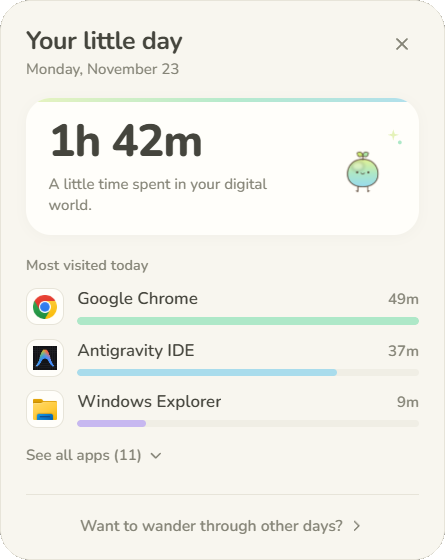
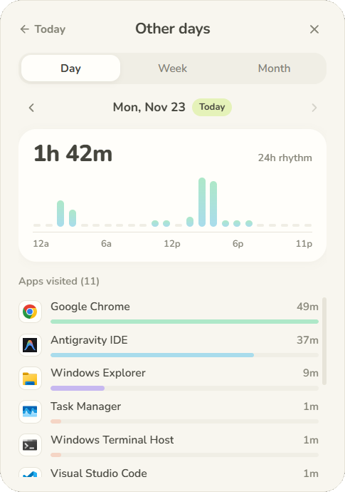
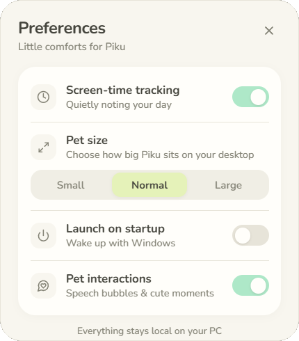
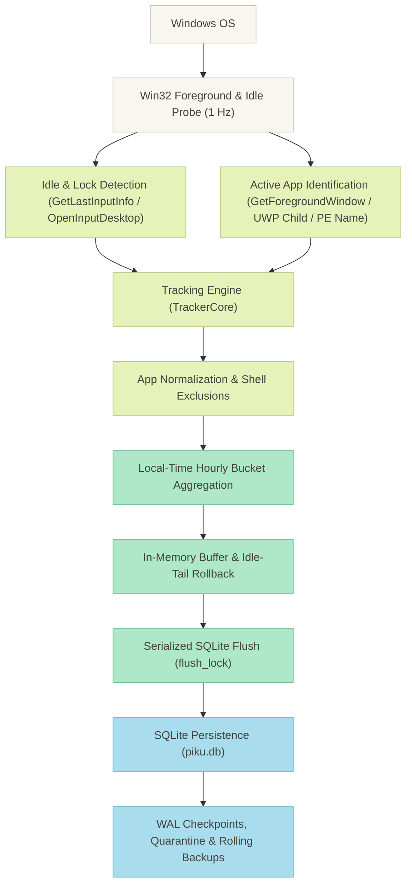
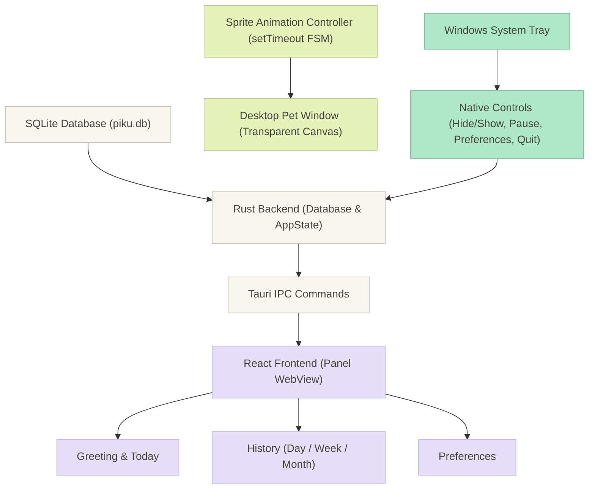

<div align="center">


# Piku

**Your little desktop companion.**

A desktop pet that quietly keeps track of the time you spend on your computer.  
Local-first, private, and open source.


<br />

[](https://github.com/AashuPatel/piku/releases/latest)

<sub>Windows x64 installer &middot; Validated on Windows 11 x64 &middot; Early controlled beta (v0.1.0)</sub>

</div>

---

## Meet Piku

Piku lives quietly on your Windows desktop—above your wallpaper, behind your work—and only opens up when you're curious about how your day went. No dashboards staring at you, no accounts, no cloud sync.

<table>
  <tr>
    <th align="center">Desktop Companion</th>
    <th align="center">Today Summary</th>
  </tr>
  <tr>
    <td align="center" valign="middle">
      <br /><br />
      
    </td>
    <td align="center" valign="middle">
      
    </td>
  </tr>
  <tr>
    <th align="center">History (Day, Week &amp; Month)</th>
    <th align="center">Preferences</th>
  </tr>
  <tr>
    <td align="center" valign="middle">
      
    </td>
    <td align="center" valign="middle">
      
    </td>
  </tr>
</table>

---

## Features

- **Lightweight desktop companion** — Transparent, non-activating desktop-layer pet that never steals focus or clutters Alt+Tab and the taskbar.
- **Automatic foreground tracking** — Quietly records active Windows applications, including UWP/packaged apps, while excluding the desktop, taskbar, and Windows shell overlays.
- **Accurate idle & lock handling** — Detects locked screens and rolls back inactive idle tails cleanly across periodic SQLite flushes so away time is not credited.
- **Today summary** — Click Piku to check your total time today and your most visited applications with cached native icons.
- **Day, Week & Month history** — Explore your 24-hour daily rhythm, 7-day breakdown, and monthly activity heatmap.
- **Animated Piku character** — Timer-driven sprite animations (`idle`, `blink`, `sleep`, `wave`, `happy`, `click`) with optional cozy speech bubbles.
- **Customizable & unobtrusive** — Drag Piku anywhere on your desktop, pick Small / Normal / Large size, pause tracking anytime, or hide Piku from the system tray.
- **Local SQLite storage** — All history and preferences stay on your PC with WAL mode, integrity checks, and validated rolling local backups. No account or cloud dependency.

---

## How Piku Works

### 1. Screen-Time Capture & Storage



- **Active app identification:** Samples the active foreground window once per second via Win32 APIs, resolves UWP child processes hosted under `ApplicationFrameHost.exe`, and reads friendly display names from local PE metadata.
- **Normalization & exclusions:** Lowercases and sanitizes executable identities and excludes Piku itself, lock/login screens, Windows shell/search/input overlays, and Explorer desktop/taskbar chrome (while still tracking real File Explorer windows).
- **Idle detection & rollback:** Tracks system inactivity via `GetLastInputInfo`. When idle crosses the 300-second threshold, Piku deducts the inactive tail both from memory and transactionally from already-flushed SQLite rows—clamping safely at `0`.
- **Hourly buckets & flushing:** Splits active intervals cleanly across local hour and midnight boundaries, flushing every 30 seconds as well as on app switch, idle, lock, pause, or shutdown under a serialized `flush_lock`.
- **Recovery & local backups:** Uses SQLite WAL mode, runs `PRAGMA wal_checkpoint(TRUNCATE)` and creates validated `VACUUM INTO` rolling snapshots (`bak.1`, `bak.2`) on clean shutdown, and quarantines corrupted database sets before restoring from backup.

### 2. Data Delivery & UI



- **Rust backend (`src-tauri/`):** Owns all OS probing, Win32 desktop-layer windowing, single-instance locking, startup Registry reconciliation, SQLite access, and shutdown persistence.
- **Tauri IPC:** The React frontend never touches SQLite or Windows APIs directly; every query, preference update, and window action passes through explicit Tauri commands (`src-tauri/src/commands.rs`).
- **React UI (`src/`):** Auxiliary panels (`Greeting`, `Today`, `History`, `Preferences`) are created on demand and destroyed on close. History and Preferences load zero sprite assets and suspend panel animation timers automatically.

For a deeper technical walkthrough, see [docs/architecture.md](docs/architecture.md).

---

## Privacy & Local Data Storage

Piku observes the active Windows foreground application (executable filename, file path for local icon/name lookup, Explorer window class for desktop/taskbar exclusion, and OS idle/lock state) solely to measure screen time locally.

Piku **never** records window titles, browser URLs, keystrokes, clipboard contents, or screenshots. Verified against the source code and dependencies, Piku includes **no analytics, no telemetry, no accounts, and no runtime external network requests**. *(During installation only, if Microsoft Edge WebView2 Runtime is missing on Windows, the NSIS installer downloads Microsoft's official WebView2 Evergreen Bootstrapper.)*

All local data is stored in a single per-user folder:

```text
%LOCALAPPDATA%\com.piku.desktop\
├── piku.db              # Primary SQLite database
├── piku.db-wal          # SQLite WAL sidecar (truncated on clean shutdown)
├── piku.db-shm          # SQLite shared-memory sidecar
├── backups/             # Validated rolling local backups (up to 2 snapshots)
├── icon-cache/          # Locally cached application PNG icons
└── pet_state.json       # Legacy pre-SQLite state file (migrated once if present)
```

Uninstalling Piku removes `%LOCALAPPDATA%\Piku\` and cleans up the per-user startup Registry entry while **preserving your data directory by default**, so reinstalling restores your history and preferences. You can delete `%LOCALAPPDATA%\com.piku.desktop\` anytime to remove all local data permanently.

Read more in [docs/privacy.md](docs/privacy.md) and [docs/data-storage.md](docs/data-storage.md).

---

## Installation

1. Open [GitHub Releases](https://github.com/AashuPatel/piku/releases/latest).
2. Download the latest Windows x64 installer (`Piku_0.1.0_x64-setup.exe`) and optionally verify its hash against `SHA256SUMS.txt`.
3. Run the installer. It installs per-user into `%LOCALAPPDATA%\Piku` without requiring administrator privileges.
4. Launch **Piku** from the Start Menu or finish screen.
5. Click Piku on your desktop or find the Piku icon in the Windows system tray to view your day, pause tracking, or open **Preferences**.

> **Note about Windows SmartScreen:** Piku's early beta installer is not yet signed with a paid Windows Authenticode code-signing certificate, so Windows Defender SmartScreen may display an *"Unknown publisher"* warning when you first run a downloaded copy. Verify the file's SHA-256 checksum against the GitHub Release before choosing **More info → Run anyway** (or build directly from source below).

---

## Tech Stack

- **Backend & Native Windows Integration:** Rust, Tauri 2, Windows Win32 APIs (`windows-sys`)
- **Storage:** SQLite (`rusqlite` with bundled SQLite)
- **Frontend:** React, TypeScript, Vite, Canvas 2D

---

## Build from Source

**Prerequisites (Windows 11 x64 validated):** Node.js 20+, `pnpm`, Rust stable toolchain (`x86_64-pc-windows-msvc`), Visual Studio C++ Build Tools, and Microsoft Edge WebView2 Runtime.

```powershell
# 1. Install frontend dependencies
pnpm install

# 2. Run in development mode
pnpm tauri dev

# 3. Run Rust unit & integration tests
cd src-tauri
cargo test
cd ..

# 4. Build production frontend & Windows x64 NSIS installer
pnpm tauri build --bundles nsis
```

See [docs/building-from-source.md](docs/building-from-source.md) for full developer setup details.

---

## Roadmap

**Implemented (v0.1.0 Controlled Beta)**
- Transparent Windows desktop-layer pet with 6 sprite animations, drag persistence, and tray controls
- Accurate 1 Hz foreground & UWP tracking with shell exclusions and live idle-tail rollback
- Today summary, Day/Week/Month history views, and Preferences
- Local SQLite WAL storage, flush serialization, shutdown checkpoints, rolling backups, and corruption quarantine
- Per-user Windows x64 NSIS installer with startup Registry reconciliation and data-preserving uninstall

**Planned**
- Once-daily in-session rolling backup refresh while Piku remains open continuously across multiple days
- Physical multi-monitor hardware validation and fresh-machine install/upgrade verification
- Code-signed Windows release binaries

**Under Consideration**
- Optional user-managed application exclusion list in Preferences
- CSV / JSON local export of screen-time history
- Production hand-illustrated character sprite pack replacing the initial programmatic sprite set

---

## Contributing & License

- Contributions, bug reports, and ideas are welcome—see [CONTRIBUTING.md](CONTRIBUTING.md).
- To report a security or privacy issue responsibly, see [SECURITY.md](SECURITY.md).
- Release history is tracked in [CHANGELOG.md](CHANGELOG.md).

**License & Third-Party Attribution**
- Licensed under the **MIT License** (see [LICENSE](LICENSE)).
- Typography uses **Nunito** via `@fontsource/nunito` (SIL Open Font License 1.1).
- UI utility icons use **Lucide** via `lucide-react` (ISC License).
- Built on Tauri, React, Vite, and SQLite.
